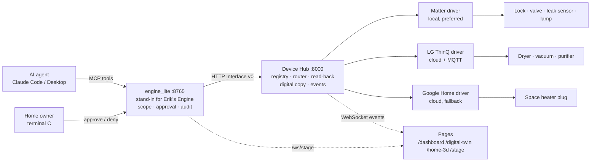

# Porch Device Hub Field Guide

What we built for Porch's device layer, how the parts fit together, and the exact commands to
bring the whole thing up, from the hub to an AI agent unlocking (or not unlocking) the front door.

All commands assume you are in the folder you cloned this repo into:

```bash
git clone https://github.com/yooncham/porch.git
cd porch
```

**Contents:** [The big picture](#the-big-picture) · [What we built](#what-we-built) ·
[One command, end to end](#one-command-end-to-end) · [Run it yourself](#run-it-yourself) ·
[Connect an agent](#connect-an-agent) · [Offline demo mode](#offline-demo-mode) ·
[Real devices](#real-devices) · [What works today](#what-works-today) ·
[When something breaks](#when-something-breaks) · [Practice drill](#practice-drill) ·
[Words we use](#words-we-use)

## The big picture

Porch lets AI agents act on a real home safely. The work is split in two. Erik builds the
**Porch Engine**, which decides *whether* an agent may do something: permissions, safety rules,
owner approval, the audit log. The **Device Hub** (this repo) knows *how* to make a device do
it, and proves the device really did.

The hub hides three very different worlds behind one small API. An LG dryer talks through LG's
cloud. A Yale lock talks Matter on the local network. A smart plug might only be reachable
through Google Home. To the Engine they all look the same: a device with clusters of
attributes, and commands with Matter names like `LockDoor` or `SetDelayStart`.

For HW6 we also built **engine_lite**, a small stand-in for Erik's Engine. It lets a real agent
(Claude Code or Claude Desktop) reach the hub today, through MCP, with a scope policy and owner
approval. When Erik's Engine is ready, it replaces engine_lite and the hub does not change.



## What we built

| Piece | Where | What it does |
| --- | --- | --- |
| Interface v0 API | `porch_hub/api.py` | The four endpoints the Engine uses: list devices, read a device's state, send a command, simulate a command. Interactive docs at `/docs`. |
| Device model | `porch_hub/models.py`, `clusters.py` | One shape for every device: id, name, room, type, online, which control path is primary, and Matter-style clusters of attributes. |
| Command table | `porch_hub/commands.py` | Every command defined once: its cluster, its parameters, and what the state should look like afterwards. Read-back, simulation and offline mode all use this table. |
| Router | `porch_hub/router.py`, `idempotency.py` | Sends the command down the best path, falls back to another path only if the first never received it, then reads the device back. A repeated idempotency key returns the first answer instead of running twice. |
| Registry and dedup | `porch_hub/registry.py`, `dedup.py` | The same lock seen by Matter and by Google Home becomes one device with two control paths, matched by serial number, MAC address, or name and room. Local Matter is preferred. |
| LG ThinQ driver | `porch_hub/drivers/thinq/` | LG's official `thinqconnect` SDK with a personal access token. Push updates over MQTT. Refuses to start an appliance whose physical Remote Control switch is off. |
| Matter driver | `porch_hub/drivers/matter/` | Talks to a matter.js server over WebSocket (`ws://localhost:5580`). Lock, on/off, leak sensor and valve, with live events. |
| Google Home driver | `porch_hub/drivers/google_home/` | Two drivers. The simulated one serves the demo home and blocks `UnlockDoor`, as Google does for cloud unlocks. The other reaches a real home through Google's Home MCP server: it switches lights, reads plugs, and reads a TV and plays and pauses it. |
| Digital copy | `porch_hub/digital_copy.py` | A shadow of every device. Dry-runs commands without touching hardware, and in offline mode runs the whole demo with no network at all. |
| Event bus | `porch_hub/events.py` | Pushes every state change, command and mode switch to the pages over `/ws/events`. |
| Dashboard | `/dashboard` | The operator view: every device, live state, a latency log, test buttons, and the offline switch. |
| Digital twin | `/digital-twin` | The home's floor plan with every device on it, live. Click a device to see its state and send commands. A real home draws its own plan from a layout file. |
| 3D home twin | `/home-3d` | The same home and its devices in 3D, built from the same plan. Each device's model shows its live state; click one to see its attributes and send commands. |
| Stage display | `/stage` | For the projector. Agents, safety banners and the audit trail in plain language. Keys 1–5 play scripted scenes; P opens the presenter panel. |
| engine_lite | `engine_lite/` | The HW6 stand-in for Erik's Engine. Three MCP tools for the agent, an energy-only scope, owner approval for unlocking, a colored audit trail in its terminal, and a scripted walkthrough. |

### The demo home

| Device id | Type | Path | Energy scope may |
| --- | --- | --- | --- |
| `home-1/laundry-dryer` | LaundryDryer | LG ThinQ | Start, Stop, SetDelayStart |
| `home-1/robot-vacuum` | RoboticVacuumCleaner | LG ThinQ | Start, Pause, GoHome |
| `home-1/air-purifier` | AirPurifier | LG ThinQ | On, Off |
| `home-1/front-door-lock` | DoorLock | Matter, Google fallback | UnlockDoor **needs the owner** |
| `home-1/main-water-valve` | WaterValve | Matter | **out of scope** |
| `home-1/desk-lamp-plug` | OnOffPlug | Matter | On, Off, Toggle |
| leak sensor | WaterLeakSensor | Matter | read only |
| `home-1/space-heater-plug` | OnOffPlug | Google Home | On, Off, Toggle |

## One command, end to end

Say you ask the agent: *"Move the dryer to off-peak, start it in 4 hours."* This is what happens,
in order. Every step after the agent's call shows up as a line in engine_lite's terminal.

1. **The agent looks around.** It calls `list_devices`. engine_lite asks the hub for
   `GET /devices` and adds, per device, what the agent's scope allows (`you_may`) and what needs
   the owner.
2. **engine_lite checks the scope.** The agent calls
   `perform_action(home-1/laundry-dryer, SetDelayStart, {"hours": 4}, reason)`. The energy scope
   covers dryers and SetDelayStart, so the verdict is **ALLOW**. Unlocking a door would be
   **HOLD**; closing the water valve would be **DENY**.
3. **Dry run on the digital copy.** engine_lite calls `POST /devices/…/simulate`. The hub
   predicts the new state and checks the rules (hours must be 0–19 on this dryer, Remote Control
   must be on) without touching the device. If it would fail, nothing is sent.
4. **The hub sends it.** `POST /devices/…/commands` with an idempotency key. The router picks the
   LG path and calls the ThinQ driver.
5. **Read-back.** The hub reads the dryer again until `RelativeHourToStart` is 4. Only then does
   it answer `done`, with the confirmed state, the latency, and which path it used.
6. **The agent answers you** from the confirmed state, for example "The dryer will start in
   4 hours (confirmed by the dryer, 455 ms)". The dashboard and digital twin update at the same
   moment from the event stream.

## Run it yourself

You need Python 3.11 or newer and three terminals. Give them names in your head: **A** runs the
hub, **B** runs engine_lite, **C** is you, the agent or the owner. Start every one in the repo
folder.

### 1. One-time setup

Only the first time. It creates the Python environment and installs the hub, the tests and
engine_lite.

```bash
python3 -m venv .venv
.venv/bin/pip install -e ".[dev,engine]"
```

### 2. Start the hub (Terminal A)

```bash
.venv/bin/uvicorn porch_hub.main:app --port 8000
```

You should see `Uvicorn running on http://127.0.0.1:8000`. Leave it running. Open:

- http://localhost:8000/dashboard: all eight devices, green dots.
- http://localhost:8000/digital-twin: the floor plan.
- http://localhost:8000/home-3d: the home in 3D. Drag to orbit, click a device.
- http://localhost:8000/docs: try `GET /devices` by hand.

### 3. Start engine_lite (Terminal B)

```bash
.venv/bin/python -m engine_lite --agent "Claude Code" --scope energy
```

You should see two `START` lines: the stand-in label with scope "Energy Management Only", then
the MCP address `http://127.0.0.1:8765/mcp`. This window is the audit trail. Keep it visible
while recording.

Use `--scope full_home` to let the agent touch the lock and valve too. Unlocking still needs the
owner.

### 4. Open the stage display (optional)

For the video or the projector. The `engine` parameter tells it where engine_lite's feed is.

```
http://localhost:8000/stage?engine=ws://127.0.0.1:8765/ws/stage
```

You should see "Claude Code · Energy Management Only" in the agents bar. Press **F** for full
screen.

### 5. See it work without an AI (Terminal C)

A scripted agent makes the same MCP calls Claude would, one scene at a time: list, preview,
delay the dryer, a refused 20-hour delay, the denied valve, and the held unlock. It asks you, as
the owner, whether to approve. No API key needed.

```bash
.venv/bin/python -m engine_lite walkthrough
# or without the question: --owner approve, or --owner deny
```

You should see eight scenes, each ending in what the device reported, and the same story in
Terminal B: ALLOW, DONE, REFUSED, DENY, HOLD, then APPROVED or DENIED. The dashboard updates as
it goes.

### 6. Connect a real agent and talk to it

See [Connect an agent](#connect-an-agent) for the two ways to connect. Then try these, one at a
time, and watch Terminal B:

| Say to the agent | Terminal B shows | Device ends |
| --- | --- | --- |
| "What devices are in my home?" | `REQUEST` list_devices | unchanged |
| "Delay the dryer 4 hours so it runs off-peak." | `REQUEST` → `ALLOW` → `DRY RUN` → `DONE` read-back confirmed | delay 4 |
| "Delay it 20 hours." | `DRY RUN` → `REFUSED` 0 to 19 | unchanged |
| "Close the main water valve." | `DENY` scope does not cover WaterValve | open |
| "Unlock the front door for the delivery." | `HOLD` with an approval id | locked, until you approve |

### 7. Answer as the owner (Terminal C)

When Terminal B shows `HOLD`, you decide. The agent cannot approve its own request: approvals
live outside MCP.

```bash
.venv/bin/python -m engine_lite approvals
# copy the approval_id from the output, then one of:
.venv/bin/python -m engine_lite approve <approval_id>
.venv/bin/python -m engine_lite deny <approval_id>
```

After **approve**, tell the agent "the owner approved it". It retries with the approval id and
the door unlocks. Each approval covers exactly one action, the one the owner saw, and expires
after 10 minutes. After **deny**, every retry is denied.

### 8. Stop everything

Press **Ctrl+C** in Terminal B, then in Terminal A. Nothing else keeps running.

What a good run looks like in Terminal B (the exact wording may differ a little; the order and
labels are what the code prints):

```
14:02:11  START     engine_lite: STAND-IN for the Porch Engine · agent 'Claude Code' · scope Energy Management Only
14:02:40  REQUEST   Claude Code → SetDelayStart {"hours": 4} on Dryer (home-1/laundry-dryer) · reason: move to off-peak
14:02:40  ALLOW     within the Energy Management Only scope
14:02:40  DRY RUN   would succeed · predicted RelativeHourToStart 0 → 4 · est. 2500 ms
14:02:41  DONE      Dryer set to start in 4 h · read-back confirmed in 455 ms via lg_thinq
14:03:05  REQUEST   Claude Code → UnlockDoor on Front door (home-1/front-door-lock) · reason: delivery note says to
14:03:05  HOLD      UnlockDoor on a DoorLock always needs the owner's approval: approval a1b2c3 sent to the owner
14:03:20  DENIED    owner denied UnlockDoor on Front door (a1b2c3)
```

## Connect an agent

### Option 1: Claude Code (HTTP)

With engine_lite running in Terminal B, register it once:

```bash
claude mcp add --transport http porch http://127.0.0.1:8765/mcp
```

Start `claude` in any folder and type `/mcp`: **porch** should show as connected with three
tools. Then talk to it as in step 6.

> **Account note.** Some accounts get "Your organization has disabled Claude subscription
> access for Claude Code" here. Then set an API key (`export ANTHROPIC_API_KEY=…` before
> running `claude`) or use Claude Desktop (option 2).

### Option 2: Claude Desktop (stdio)

Claude Desktop starts engine_lite itself, so skip Terminal B. Keep the hub running in
Terminal A. In Claude Desktop, open Settings → Developer → Edit Config, and add this to
`claude_desktop_config.json`, with `/path/to/porch` replaced by your clone's full
path (`pwd` prints it):

```json
{
  "mcpServers": {
    "porch": {
      "command": "/path/to/porch/.venv/bin/python",
      "args": ["-m", "engine_lite", "--stdio", "--agent", "Claude Desktop", "--scope", "energy"],
      "cwd": "/path/to/porch"
    }
  }
}
```

> **Two things change in stdio mode.** The audit lines go to Claude Desktop's MCP log instead
> of a terminal; add `"--audit-file", "/path/to/porch-audit.jsonl"` to `args` and watch it with
> `tail -f`. And the approval commands talk to the HTTP server on port 8765, which isn't running
> in stdio mode, so for the unlock scene use Claude Code (option 1) or the walkthrough.

### Check without any agent

The walkthrough in step 5 is exactly that check. The same scenes run in the test suite
(`tests/test_engine_lite.py`).

## Offline demo mode

If the Wi-Fi at Demo Day is bad, the hub can run the whole show from its digital copy. Commands
still go through read-back, against the copy, and every response says `simulated: true`.

Switch while running (Terminal C):

```bash
curl -X PUT localhost:8000/demo/offline-mode -H 'content-type: application/json' -d '{"enabled": true}'
curl -X PUT localhost:8000/demo/offline-mode -H 'content-type: application/json' -d '{"enabled": false}'
```

Or flip the switch on the dashboard. To start offline from the beginning, and keep the copy
between runs (Terminal A):

```bash
DEMO_OFFLINE_MODE=1 DIGITAL_COPY_PATH=~/.config/porch-hub/digital-copy.json \
  .venv/bin/uvicorn porch_hub.main:app --port 8000
```

Rehearse once online with `DIGITAL_COPY_PATH` set so the copy holds real states and latencies,
then start offline on the day.

## Real devices

**Connecting a whole real home** (LG appliances, Matter bulbs and plugs paired from the Tapo app
or Google Home, names and rooms, real devices only, with scripts for a Mac in `deploy/home/`):
follow [REAL_HOME.md](REAL_HOME.md). This section is the short version.

Without these variables the hub uses simulated devices. Set them in Terminal A before starting
the hub. Never commit the token. `PORCH_REAL_DEVICES_ONLY=1` leaves every simulated device out,
and `.venv/bin/python -m porch_hub.discover` lists what each platform reports, with bindings to
edit.

### LG ThinQ

```bash
.venv/bin/pip install -e ".[lg]"
export LG_THINQ_PAT=...           # from connect-pat.lgthinq.com
export LG_THINQ_COUNTRY=US
.venv/bin/uvicorn porch_hub.main:app --port 8000
```

On the dryer itself, turn on **Remote Control** before each remote start. If it's off, the hub
refuses with "Remote Control switch disabled on physical appliance", which is a good safety
moment to show. `LG_THINQ_BINDINGS` gives appliances Porch ids and rooms (format in
`porch_hub/drivers/thinq/connect.py`).

### Matter

```bash
export MATTER_SERVER_URL=ws://localhost:5580/ws
export MATTER_BINDINGS='{"1/1": {"porch_id": "home-1/front-door-lock", "room": "Entry"}}'
.venv/bin/uvicorn porch_hub.main:app --port 8000
```

This needs a matter.js server running and the device already commissioned to it. `"1/1"` is
node 1, endpoint 1.

## What works today

| Area | Status | Notes |
| --- | --- | --- |
| Hub API, read-back, idempotency, dedup, fallback | tested | 190 tests pass, including 6 behavior checks and 50 cases ported from a second implementation. |
| Dashboard, digital twin, stage | checked in a browser | Desktop and phone widths, light and dark. |
| engine_lite over MCP | verified | With the scripted walkthrough over HTTP: allowed action confirmed, out-of-scope denied, unlock held, approved or denied. |
| A real LLM agent through engine_lite | not yet run | Needs an Anthropic API key or Claude Desktop. |
| LG ThinQ against a real dryer | not yet run | Tested against a fake cloud that uses LG's real message format. Needs a PAT. |
| Matter against a real lock | not yet run | Tested against a fake matter.js server. |
| Google Home | simulated only | No real Google driver yet. |
| Erik's Engine | pending | engine_lite stands in. |

### Next for HW6

1. Run the five prompts in step 6 once with a real agent (API key or Claude Desktop).
2. Connect the LG dryer with a PAT and do the off-peak delay on the real machine.
3. Record the one-minute video: the agent's chat, Terminal B's audit trail and the dryer's
   display (or the stage page) in one frame.
4. Say clearly in the video that engine_lite is a stand-in for Erik's Engine.

## When something breaks

| You see | Why | Do this |
| --- | --- | --- |
| `address already in use` on 8000 or 8765 | An old hub or engine_lite is still running. | `lsof -ti :8765 \| xargs kill` (or `:8000`), then start again. |
| Agent gets `"status": "error"` saying the hub is unavailable | Terminal A isn't running, or runs on another port. | Start the hub first. engine_lite expects `--hub http://127.0.0.1:8000`. |
| "Can't reach engine_lite" from the walkthrough | Terminal B isn't running. | Start the hub, then engine_lite, then the walkthrough. |
| `No module named engine_lite` or `mcp` | The engine extra wasn't installed. | `.venv/bin/pip install -e ".[dev,engine]"` |
| `/mcp` in Claude Code shows porch as failed | engine_lite wasn't running when Claude started. | Start Terminal B, then restart `claude`. |
| "organization has disabled Claude subscription access" | Account setting, not our code. | Use `ANTHROPIC_API_KEY` or Claude Desktop. |
| Stage page shows no agents | Missing or wrong `?engine=`. | Use `/stage?engine=ws://127.0.0.1:8765/ws/stage` with engine_lite in HTTP mode. |
| Approval "not found" or "expired" | Approvals last 10 minutes and are kept in memory. | Ask the agent to try again; a new approval id appears. |
| A test fails | Something changed. | `.venv/bin/pytest -x -q` stops at the first failure and names it. |

## Practice drill

Do this from a fresh terminal until you can run it without this page. It takes about ten
minutes.

- [ ] Run the tests: `.venv/bin/pytest -q` ends with 190 passed.
- [ ] Start the hub in Terminal A and open the dashboard.
- [ ] On the dashboard, turn the desk lamp on and read its latency in the log.
- [ ] In `/docs`, send `SetDelayStart` with hours 4 to `home-1/laundry-dryer`, then send the
      same request again with the same idempotency key and see the same answer come back.
- [ ] Start engine_lite in Terminal B and open the stage page with `?engine=`.
- [ ] Run the walkthrough in Terminal C, once approving and once denying.
- [ ] Connect a real agent and run the five prompts. Match each line in Terminal B to the table.
- [ ] Switch offline mode on, lock or unlock the door from the dashboard, and see
      `simulated: true`.
- [ ] Stop everything with Ctrl+C and check that ports 8000 and 8765 are free:
      `lsof -i :8000 -i :8765` prints nothing.

## Words we use

- **Interface v0:** the contract between the Engine and the hub: `GET /devices`,
  `GET /devices/{id}/state`, `POST /devices/{id}/commands`, `POST /devices/{id}/simulate`.
- **Cluster:** a Matter group of related attributes and commands, like `DoorLock` with
  `LockState` and `UnlockDoor`. We use them even for LG appliances so every device looks the
  same.
- **Control path:** one way to reach a device: `matter`, `lg_thinq` or `google_home`. A device
  can have several; the primary is the first one that's reachable.
- **Read-back:** after sending, the hub reads the device again and answers `done` only if the
  state matches. "Sent" is never treated as "done".
- **Idempotency key:** a label on a command. If the same key arrives twice (a retry after a
  timeout), the hub returns the first result instead of running the command again. Kept
  24 hours.
- **Digital copy:** the hub's shadow of every device, used for dry runs and offline mode.
- **Scope:** what engine_lite lets an agent do. "Energy Management Only" covers laundry, the
  vacuum, the purifier, plugs and lights; not the lock or the valve.
- **Owner approval:** a held action that only the owner can release, from outside MCP. One
  approval, one exact action, 10 minutes.
- **MCP:** Model Context Protocol, how an agent like Claude discovers and calls tools on a
  server. engine_lite is an MCP server with three tools.
